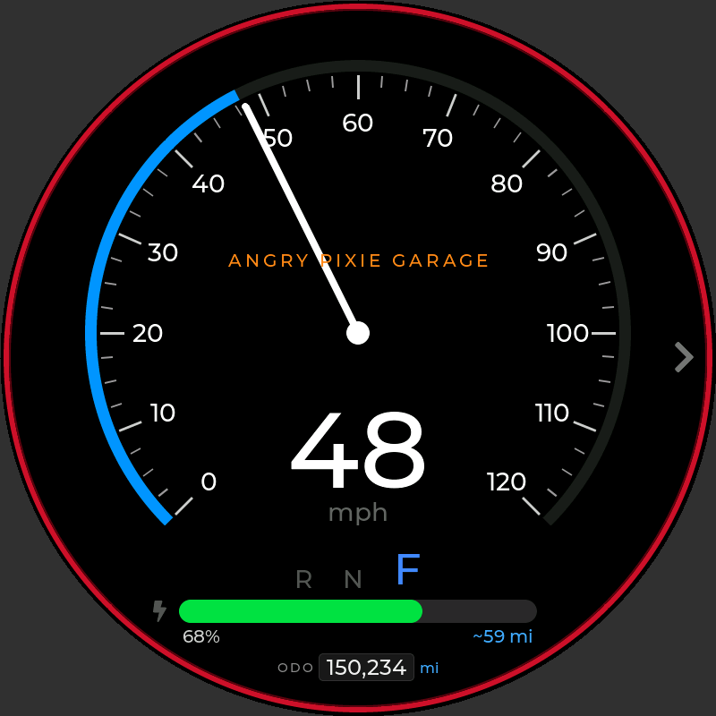
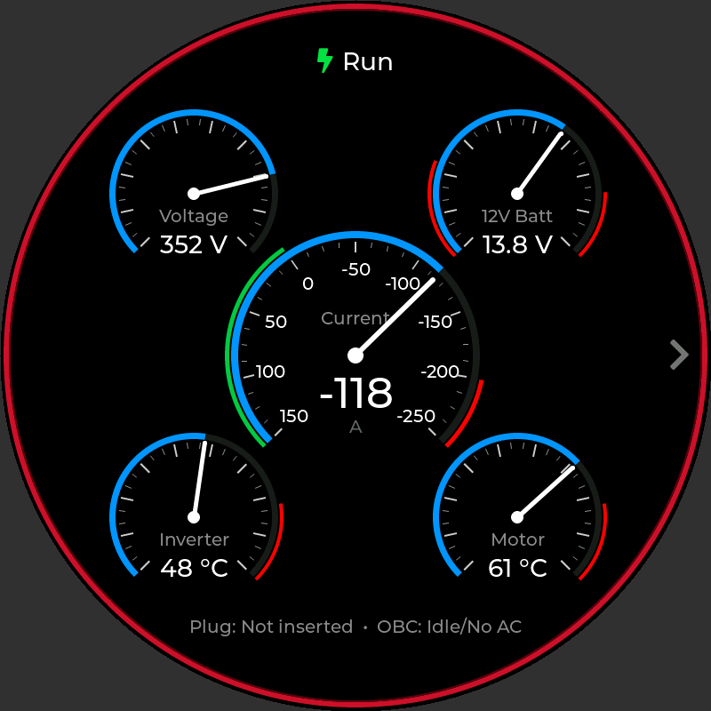
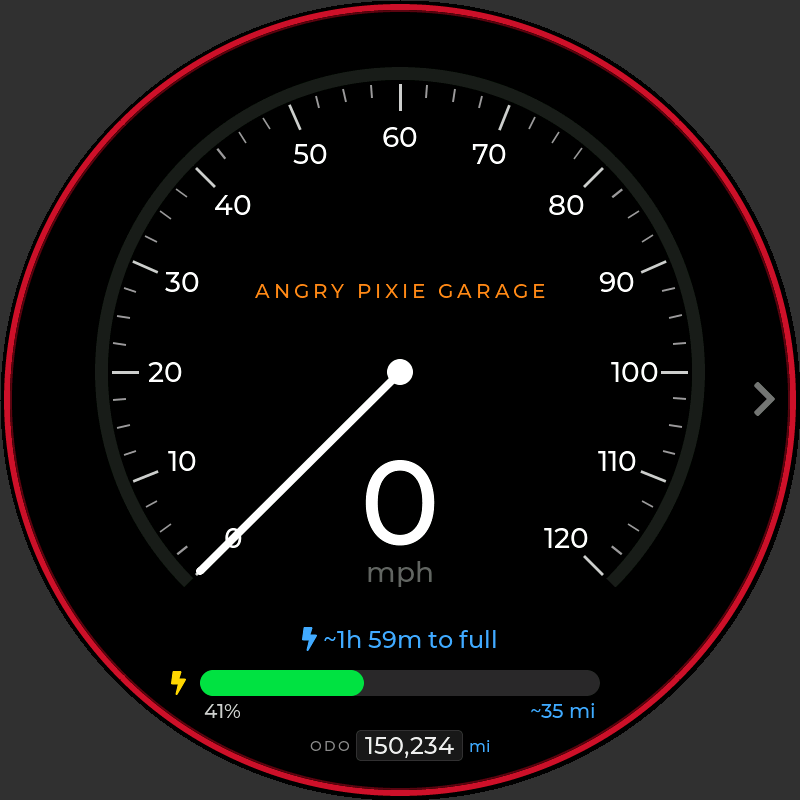
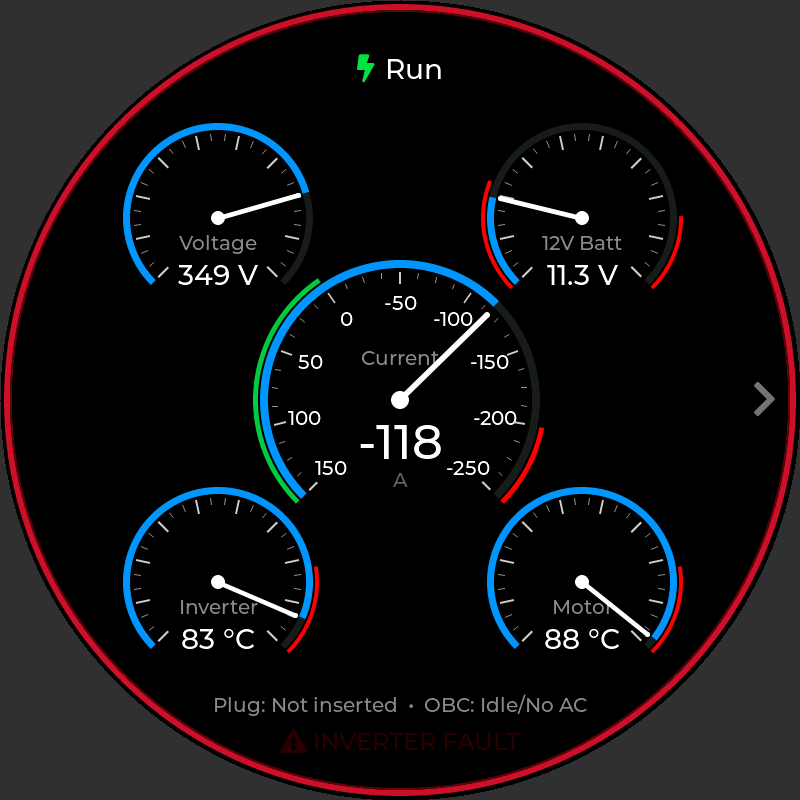
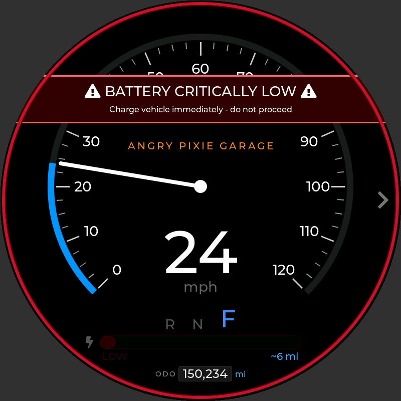
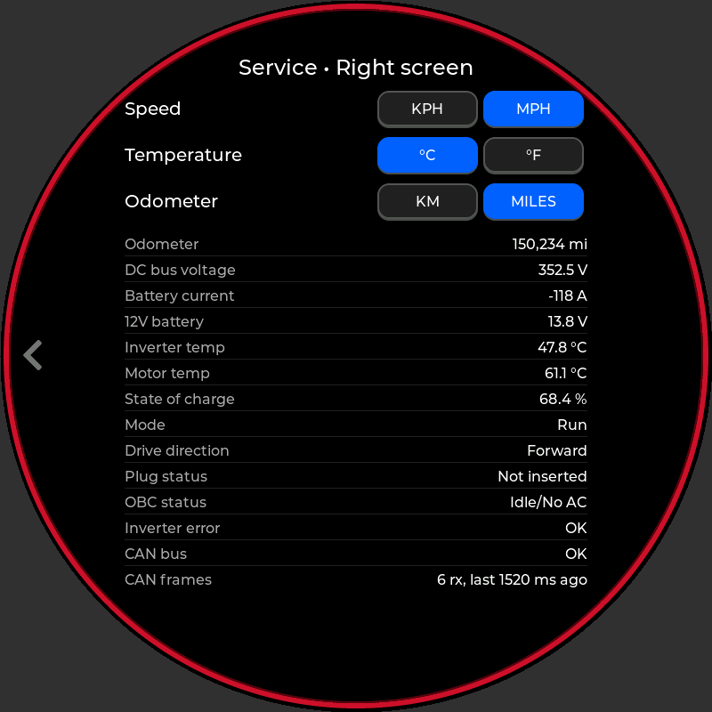

# 928 Waveshare Dash

Dash display for the Porsche 928 EV conversion, running on the
**Waveshare ESP32-P4-WIFI6-Touch-LCD-3.4C** (3.4" round 800×800 touch display).

This is a port of the [Angry Pixie web dash](https://github.com/bapshago/AngryPixieDash)
(`leaf_dash_v9`). The CAN decoding, gauges, warnings, odometer and settings are
the same, but instead of an ESP32 serving a web page to a tablet, the data is
drawn straight onto the round screen with LVGL.

The car has **two identical units**, one each side of the dash, running the same
firmware. A menuconfig setting picks which one a unit is:

| | Left screen | Right screen |
|---|---|---|
| Driving |  |  |
| Charging / fault |  |  |
| Critically low battery / service page |  |  |

- **Left:** full-screen speed gauge, R / N / F (replaced by time-to-full while
  charging), state-of-charge bar with range, odometer, low-battery warning.
- **Right:** current gauge in the middle; pack voltage, 12V, inverter and motor
  temperature around it; op mode at the top; plug and charger status at the bottom.
- **Both:** the flashing inverter-fault warning and the service page.

*Screenshots are rendered by the desktop simulator (`sim/`) from the same UI code
the board runs; the grey corners are outside the round glass.*

## Features

Carried over from the web dash:

- Large speed gauge, kph (0–160) or mph (0–120)
- Small gauges: pack voltage, 12V aux battery (red below 11.5 V / above 15 V),
  inverter and motor temperature (°C 0–90 / °F 0–200, red in the top 20 %)
- Inverted current gauge: throttle swings clockwise to −250 A, regen to +150 A,
  green regen zone, 200–250 A redline
- R / N / F drive direction and op mode (Off, Run, Pre Charge, Pre Charge Failed, Charging)
- State-of-charge bar with range estimate (22 kWh pack, 3.9 mi/kWh); red below 15 %
- **Critical low-battery warning below 10 %**: flashing banner, bar and "LOW" readout
- Estimated time to full while charging
- Plug and on-board charger status; flashing inverter fault warning
- Odometer (miles or km), seeded to 150,000 miles on first boot and integrated from motor speed
- Service / Diagnostics screen (tap the arrow on the right edge, or swipe left) with speed, temperature and odometer unit
  toggles and all raw readings. Unit settings are stored per unit, so set them on both screens
- Unit settings and the odometer persist in flash (NVS); the odometer is written at
  most every 30 s to limit flash wear
- Red bezel ring to match the car's anodized gauge bezels

New on the round display:

- Needles ease between readings (the web page used a CSS transition)
- CAN bus state, frame counters and "last frame" age on the service screen
- 12V gauge shows one decimal (13.8 V rather than 14 V)

## Hardware

| Part | Notes |
|---|---|
| Waveshare ESP32-P4-WIFI6-Touch-LCD-3.4C | ESP32-P4, 32 MB PSRAM, 32 MB flash, 800×800 MIPI-DSI round IPS, capacitive touch |
| 3.3 V CAN transceiver: SN65HVD230 breakout | The ESP32-P4 has an on-chip CAN (TWAI) controller but no transceiver. The breakout plugs onto the board's 40-pin header |
| 12 V → 5 V buck converter (LM2596 module) | One per unit, with a USB-C lead soldered to its output to power the board. Set it to 5 V and check the polarity before plugging into the board |

Wiring (defaults; change them in `idf.py menuconfig` → *928 EV Dash*):

| 40-pin header | SN65HVD230 (breakout label) | |
|---|---|---|
| GPIO35 | D / TXD (CTX) | CAN TX |
| GPIO36 | R / RXD (CRX) | CAN RX |
| 3V3 | VCC (3V3) | |
| GND | GND | |
| | CANH / CANL | to the EV-CAN bus (ZombieVerter, Leaf inverter, PDM, BMS) |

GPIO35 is also the ESP32-P4's BOOT strapping pin. That's harmless here (the
transceiver input doesn't pull it low at power-up), but holding the board's BOOT
button will drive the CAN bus dominant, so don't press it with the car on.
The bus should already be terminated at both ends; remove the 120 Ω terminator on
the transceiver breakout unless the dash is at one end of the bus.

**Building a unit?** Follow the [build guide](docs/BUILD.md): parts, metalwork,
electronics prep, firmware, assembly, wiring into the car and commissioning.

The mechanical build is in [`hardware/mechanical/`](hardware/mechanical/README.md):
- cut files for the main instrument faceplate, the Waveshare mounting brackets,
  the buck converter bracket and the CAN bus wire bracket
- bend instructions, the hand-formed shroud, the assembly stack and hardware
- build photos

## CAN messages read (500 kbit/s)

| ID | Data |
|---|---|
| 0x1DA | DC bus voltage, motor speed, inverter error |
| 0x55A | Inverter and motor temperature |
| 0x390 | OBC / charge plug status |
| 0x55B | State of charge |
| 0x1DB | Battery current |
| 0x31A | ZombieVerter: drive direction, op mode, 12V aux voltage. Needs custom TX mappings, see [docs/ZombieVerter_CAN_Mappings.md](docs/ZombieVerter_CAN_Mappings.md) |
| 0x292 | 12V battery voltage (stock Leaf CAR-CAN, if present) |

## Building and flashing

Requires [ESP-IDF](https://docs.espressif.com/projects/esp-idf/en/latest/esp32p4/get-started/)
**v5.5 or newer** (builds verified on 5.5 and 6.1). The Waveshare BSP and LVGL are fetched automatically by the
component manager on the first build.

```sh
idf.py set-target esp32p4
idf.py build
idf.py -p /dev/ttyACM0 flash monitor     # COMx on Windows
```

Options under `idf.py menuconfig` → **928 EV Dash**:

| Option | Default | |
|---|---|---|
| ESP32-P4 chip revision | v1.x | **v1.x** or **v3.x**, to match the board's chip (see below) |
| Screen side | Left | **Left** or **Right**, see above. Set this differently on the two units |
| CAN TX / RX GPIO | 35 / 36 | Transceiver pins |
| CAN bitrate | 500000 | |
| Listen-only | off | On = the dash never ACKs or transmits. Leave off on a bench with only one transmitter |
| Test mode | off | No CAN needed: every gauge sweeps its full range up and back down over 20 s, SOC 100 → 0 %, and on/off states step through in turn. Test-mode distance is not added to the odometer |
| Backlight brightness | 100 % | |

**ESP32-P4 chip revision:** Waveshare boards ship with v1.x silicon (older
boards; the first unit is v1.3) or v3.x (newer boards, e.g. v3.2). Firmware built
for one won't flash on the other: esptool stops with "requires chip revision in
range ...". The flash error, the boot log and `esptool chip-id` all print the
revision. Set **ESP32-P4 chip revision** in the menu to match the board you're
flashing (default v1.x). The two units in one car can be different revisions.

If your `sdkconfig` predates this option, delete `sdkconfig` and `build/` once
before switching to v3.x. Otherwise the build stops with a message explaining
the leftover setting.

Drivetrain constants (gear ratio 7.94, tyre circumference 1.975 m, 22 kWh pack,
3.9 mi/kWh, initial odometer) are at the top of `main/core/dash_calc.h`.

## Previewing the screen without hardware

The simulator builds the same UI code for the PC and writes PNG screenshots.
It needs a C compiler and CMake:

```sh
cmake -S sim -B build-sim && cmake --build build-sim -j
./build-sim/dash_sim drive left out.png     # one scenario on one screen
./build-sim/dash_sim --all /tmp/shots        # every scenario, both screens
```

Scenarios: `drive`, `regen`, `charging`, `lowbatt`, `fault`, `nodata`,
`metric`, `service`, `test`. They're built from synthetic CAN frames run
through the real decoder, so they exercise the same path as the car.

## Tests

The CAN decoder and calculations are plain C and are tested on the PC:

```sh
cmake -S host_test -B build-test && cmake --build build-test && ./build-test/test_core
```

## Layout

```
main/
  main.c                boot: settings + CAN, then display + UI
  dash_model.c          ESP32 side: TWAI receive, NVS settings/odometer, test mode
  core/                 portable C, no ESP-IDF: state, Leaf/ZombieVerter decoder, calculations
  ui/                   LVGL: gauge widget, driver + service screens
sim/                    desktop renderer (LVGL on the PC → PNG)
host_test/              unit tests for main/core
docs/                   build guide, screenshots, ZombieVerter CAN mapping guide
hardware/mechanical/    cut files (DXF), bend diagrams, assembly notes, build photos
```

## Differences from the web dash

- **Battery current sign fix:** 0x1DB decoding now subtracts 2048 for negative
  values (the web dash subtracted 2047, so every negative reading was 1 A too high).
- **No false low-battery alarm at key-on:** SOC, pack voltage and current show
  "--" until their first CAN frame arrives. The web dash treated a missing SOC
  as 0 %, which flashed the critical-battery banner whenever data was missing.
- **Speed in reverse:** the inverter reports reverse as negative RPM. The web
  dash showed it as a negative speed with the needle stuck at 0; this dash shows
  the speed without the sign and R / N / F shows the direction. The odometer
  counts reverse distance either way.
- **Odometer display:** miles are computed as metres ÷ 1609.344 instead of
  km × 0.621371, which rounded 150,234 down to 150,233.
- **Current scale unchanged:** 0x1DB current is used at 1 A/bit, exactly as the
  web dash did. Some Leaf decodes list this signal as 0.5 A/bit, so compare the
  gauge with a clamp meter or your BMS and adjust `leaf_can.c` if it reads double.
- **Settings don't carry over:** the NVS namespace and keys match the web dash,
  but this is a different board, so the odometer seeds fresh at 150,000 miles.
  Change `DASH_ODO_INITIAL_MILES` before first boot to start from the car's real reading.

## Odometer and the law

Once the original instrument cluster is out, the left screen **is the car's
odometer**. Misrepresenting a vehicle's mileage is illegal.

In the U.S. this is covered by federal odometer law,
[49 U.S.C. chapter 327](https://www.law.cornell.edu/uscode/text/49/subtitle-VI/part-C/chapter-327)
(sections 32701 to 32711):

- **[§ 32703](https://www.law.cornell.edu/uscode/text/49/32703)** prohibits
  selling, using or installing a device that makes an odometer register mileage
  different from the distance actually driven. It also prohibits disconnecting,
  resetting or altering an odometer to change the mileage it registers.
- **[§ 32704](https://www.law.cornell.edu/uscode/text/49/32704)** covers
  servicing and replacing an odometer, which is what fitting this dash is. The
  mileage must stay the same as before. If it can't, the odometer must be set to
  zero and a written notice fixed to the **left door frame** giving the mileage
  before the work and the date. Removing or altering that notice with intent to
  defraud is prohibited.
- **Penalties:** knowing and willful violations can bring fines and up to 3 years
  in prison ([§ 32709](https://www.law.cornell.edu/uscode/text/49/32709)). A
  person defrauded can sue for 3 times their actual damages or $10,000, whichever
  is greater, plus attorney's fees
  ([§ 32710](https://www.law.cornell.edu/uscode/text/49/32710)).
- Mileage must also be disclosed when a vehicle changes hands
  ([49 CFR part 580](https://www.ecfr.gov/current/title-49/subtitle-B/chapter-V/part-580)),
  and states have their own odometer and title laws.

What this means when you build and use this dash:

1. **Before the left unit's first boot in the car**, set `DASH_ODO_INITIAL_MILES`
   in `main/core/dash_calc.h` to the car's **true mileage**. If you can't establish
   it, set it to `0` and fix the door-frame notice that § 32704 requires.
2. **Don't change the code to lower, edit or reset the reading.** The firmware
   only counts up: reverse adds distance, test mode adds nothing, and there's no
   setting to change the stored mileage. Comments in the code mark this.
3. **Check the odometer's accuracy.** It's calculated from motor speed using
   `DASH_GEAR_RATIO` and `DASH_TIRE_CIRCUMFERENCE_M`. Compare it over a known
   distance or against GPS, and update those constants if you change the tyre size
   or the gearing.
4. **Erasing the board's flash re-seeds the odometer** to `DASH_ODO_INITIAL_MILES`.
   Only do it to carry the car's true reading over, for example onto a replacement
   unit, and set the constant to the current reading first.

This is a summary for builders, not legal advice. Laws vary by state and country;
check the rules where the car is registered.

## Disclaimer

This software and the build documentation are provided **"as is", without warranty
of any kind**, express or implied. They're a hobby project for one specific car.
The authors aren't liable for any claim, damage or other liability arising from
using, building, installing or modifying them.

If you build or install this dash, you're responsible for:

- complying with the laws that apply to your vehicle, including the odometer law
  above and any equipment, inspection and registration rules;
- making sure the odometer shows the vehicle's true mileage;
- checking that every reading is accurate before relying on it. The dash shows
  values decoded from the CAN bus and calculated from fixed constants, and it isn't
  a safety system.

